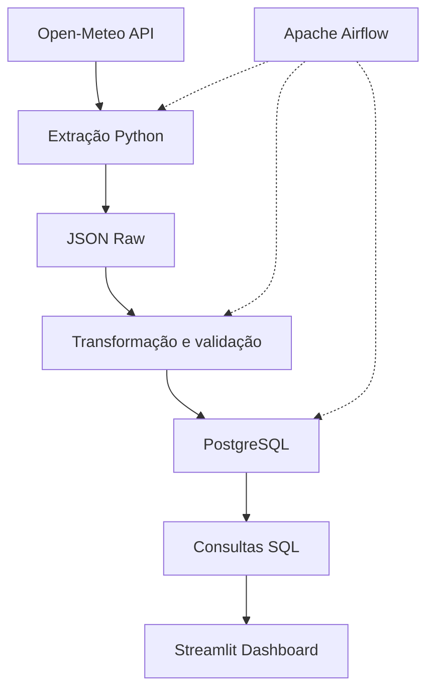

# WeatherFlow — Pipeline de Engenharia de Dados Meteorológicos

Projeto de Engenharia de Dados desenvolvido com Python,
Open-Meteo API, PostgreSQL, Apache Airflow, Docker e Streamlit.

O WeatherFlow automatiza a coleta, transformação,
armazenamento e análise de previsões meteorológicas
para diferentes cidades brasileiras.

**Status:** Etapas 1 a 5 concluídas e validadas.
Etapa 6 — Documentação e apresentação do projeto.

## 1. Problema de negócio

Empresas com operações em diferentes cidades podem
utilizar previsões meteorológicas para apoiar decisões
relacionadas a logística, planejamento e operações.

A consulta manual dessas informações dificulta:

- A padronização dos dados.
- A comparação entre cidades.
- A rastreabilidade das coletas.
- A manutenção de um histórico de previsões.
- A disponibilização de indicadores analíticos.

O WeatherFlow demonstra como resolver esses desafios
com um pipeline automatizado e uma camada de Analytics.

## 2. Objetivos

- Consumir dados meteorológicos de uma API REST.
- Preservar os dados brutos em JSON.
- Validar e transformar os registros.
- Armazenar os dados em PostgreSQL.
- Evitar duplicações durante o carregamento.
- Orquestrar o pipeline com Apache Airflow.
- Disponibilizar consultas SQL.
- Construir um dashboard com Streamlit.
- Aplicar testes automatizados e boas práticas de software.

## 3. Tecnologias

| Tecnologia | Utilização |
|---|---|
| Python 3.12 | Desenvolvimento do ETL |
| Requests | Integração HTTP com a API |
| Open-Meteo | Fonte de previsões meteorológicas |
| JSON | Preservação dos dados brutos |
| PostgreSQL | Persistência relacional |
| SQL | Consultas e agregações |
| Docker Compose | Infraestrutura local |
| Apache Airflow | Orquestração do pipeline |
| Streamlit | Dashboard analítico |
| Pytest | Testes automatizados |
| Ruff | Lint e formatação |
| UV | Gerenciamento de dependências |
| Git e GitHub | Versionamento e colaboração |

## 4. Arquitetura



O Apache Airflow coordena as tarefas do pipeline.
O Streamlit consulta os dados persistidos no PostgreSQL.

A documentação detalhada está em
[Arquitetura](docs/arquitetura.md).

## 5. Cidades monitoradas

- São Paulo — SP
- Rio de Janeiro — RJ
- Curitiba — PR

## 6. Indicadores

O WeatherFlow acompanha:

- Temperatura máxima prevista.
- Temperatura mínima prevista.
- Precipitação prevista.
- Data de referência da previsão.
- Data e horário da coleta.

Os dados representam previsões meteorológicas,
não observações históricas consolidadas.

## 7. Estrutura do repositório

```text
weatherflow/
├── .github/
│   └── workflows/
├── dags/
│   └── weatherflow_dag.py
├── dashboard/
│   └── app.py
├── data/
│   └── raw/
├── docker/
├── docs/
│   ├── arquitetura.md
│   ├── execucao.md
│   ├── observabilidade.md
│   └── evidencias/
├── sql/
├── src/
│   └── weatherflow/
│       ├── analytics.py
│       ├── config.py
│       ├── extract.py
│       ├── transform.py
│       ├── load.py
│       └── etl.py
├── tests/
├── compose.yaml
├── pyproject.toml
├── uv.lock
└── README.md
```

## 8. Instalação

### Pré-requisitos

- Python 3.12
- UV
- Git
- Docker Desktop
- PowerShell, no Windows

### Clonar o projeto

```powershell
git clone https://github.com/rafaelporfiriobarros/weatherflow.git
cd weatherflow
```

### Instalar dependências

```powershell
uv sync --locked
```

### Configuração

O projeto utiliza variáveis de ambiente para
configuração do PostgreSQL.

Consulte `.env.example` para identificar as
variáveis necessárias.

Não publique credenciais reais no GitHub.

## 9. Execução

### Extração meteorológica

```powershell
uv run python -m weatherflow.main
```

### Dashboard

```powershell
uv run streamlit run dashboard/app.py
```

Acesse:

http://localhost:8501

A execução completa do ETL, PostgreSQL e Airflow
está documentada em
[Guia de Execução](docs/execucao.md).

## 10. Modelagem e idempotência

Os dados meteorológicos são persistidos na tabela
`weather_forecasts`.

A estratégia de unicidade considera:

- `city`
- `forecast_date`
- `collected_at`

Isso permite reexecutar o carregamento da mesma
coleta sem inserir registros duplicados.

Coletas realizadas em horários diferentes podem
representar versões distintas da previsão.

## 11. Analytics e Streamlit

O dashboard permite:

- Consultar previsões recentes.
- Filtrar informações por cidade.
- Filtrar informações por período.
- Visualizar indicadores meteorológicos.
- Comparar temperaturas.
- Analisar precipitação prevista.
- Consultar uma tabela analítica.
- Exportar resultados em CSV.

A camada analítica está implementada em
`src/weatherflow/analytics.py`.

## 12. Testes automatizados

Executar:

```powershell
uv run pytest -q
```

Resultado validado na conclusão da Etapa 5:

**63 testes aprovados.**

Os testes abrangem componentes do pipeline,
consultas analíticas e interface Streamlit.

Os testes do dashboard utilizam AppTest e mocks,
permitindo validar cenários sem depender de
consultas reais ao PostgreSQL.

## 13. Qualidade de código

```powershell
uv run ruff check .
uv run ruff format --check .
```

Na conclusão da Etapa 5:

- 63 testes aprovados.
- Ruff sem erros.
- 21 arquivos formatados.
- Branch `main` sincronizada.

## 14. Segurança e confiabilidade

O projeto utiliza:

- Variáveis de ambiente para configurações sensíveis.
- Arquivos `.env` fora do versionamento.
- Tratamento de erros HTTP.
- Validação de dados recebidos.
- Testes automatizados.
- Persistência com prevenção de duplicações.
- Separação entre extração, transformação,
  armazenamento e apresentação.

## 15. Limitações

O WeatherFlow é um projeto educacional.

Suas principais limitações incluem:

- Monitoramento de apenas três cidades.
- Dependência de disponibilidade da API externa.
- Execução em infraestrutura local.
- Ausência de monitoramento operacional avançado.
- Ausência de comparação com medições observadas.

## 16. Roadmap

| Etapa | Descrição | Status |
|---|---|---|
| 1 | Fundação e Engenharia de Software | Concluída |
| 2 | Integração com Open-Meteo | Concluída |
| 3 | Transformação e PostgreSQL | Concluída |
| 4 | Apache Airflow e Docker | Concluída |
| 5 | Analytics e Streamlit | Concluída |
| 6 | Documentação e observabilidade básica | Em andamento |

## 17. Aprendizados

### Engenharia de Software

- Modularização e separação de responsabilidades.
- Gerenciamento de dependências.
- Tratamento de exceções.
- Testes automatizados.
- Mocks e testes de interface.
- Lint e formatação.
- Git, branches e Pull Requests.

### Engenharia de Dados

- Integração com APIs REST.
- Extração e preservação de JSON.
- Transformação e validação de dados.
- Modelagem relacional.
- SQL analítico.
- Idempotência.
- Orquestração de pipelines.
- Construção de indicadores.

## 18. Conclusão

O WeatherFlow demonstra a construção incremental
de uma solução de Engenharia de Dados, integrando
fundamentos de Engenharia de Software, processamento
ETL, persistência relacional, orquestração e Analytics.

O foco não é utilizar o maior número possível de
ferramentas, mas construir uma solução compreensível,
testável, reproduzível e adequada ao problema proposto.

## Autor

Rafael Porfírio Barros

[GitHub](https://github.com/rafaelporfiriobarros)

## Referências

- [Open-Meteo](https://open-meteo.com/en/docs)
- [Python](https://docs.python.org/3.12/)
- [PostgreSQL](https://www.postgresql.org/docs/)
- [Apache Airflow](https://airflow.apache.org/docs/)
- [Streamlit](https://docs.streamlit.io/)
- [UV](https://docs.astral.sh/uv/)
- [Pytest](https://docs.pytest.org/)
- [Ruff](https://docs.astral.sh/ruff/)
