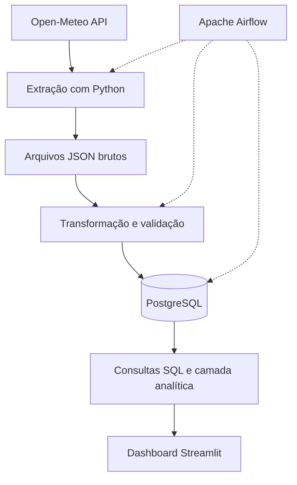
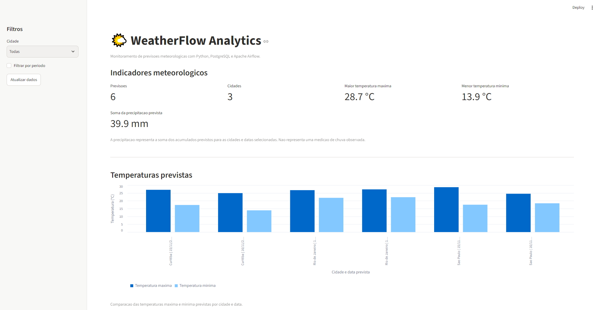

# WeatherFlow — Pipeline de Engenharia de Dados Meteorológicos

**Pipeline end-to-end de previsões meteorológicas com Python, Open-Meteo, PostgreSQL, Apache Airflow, Docker e Streamlit.**

O **WeatherFlow** coleta previsões meteorológicas de cidades brasileiras, preserva as respostas brutas em JSON, transforma e valida os dados, armazena os resultados em PostgreSQL e disponibiliza indicadores em um dashboard Streamlit. A execução do pipeline é orquestrada pelo Apache Airflow.

**Status:** projeto concluído — etapas 1 a 6 implementadas e validadas localmente.

**[Arquitetura](docs/arquitetura.md) · [Guia de execução](docs/execucao.md) · [Observabilidade](docs/observabilidade.md) · [Evidências técnicas](docs/evidencias.md)**

## 1. Problema de negócio

Empresas com operações em diferentes cidades podem usar previsões meteorológicas para apoiar o planejamento logístico e operacional. Quando a consulta é manual, surgem dificuldades para padronizar informações, comparar localidades, rastrear coletas e disponibilizar indicadores consistentes.

O WeatherFlow demonstra uma solução de Engenharia de Dados para centralizar essas previsões e torná-las acessíveis para análise. **Os dados representam previsões, não medições meteorológicas observadas.**

## 2. Objetivos

- Consumir dados de uma API REST pública.
- Preservar os dados brutos em arquivos JSON.
- Validar e transformar registros com Python.
- Armazenar previsões em PostgreSQL, preservando o histórico das coletas.
- Evitar duplicações ao reprocessar a mesma coleta.
- Orquestrar a execução com Apache Airflow.
- Aplicar verificações de integridade com SQL e testes automatizados.
- Disponibilizar indicadores e filtros em um dashboard Streamlit.

## 3. Tecnologias

| Tecnologia | Papel no projeto |
|---|---|
| Python 3.12 | Extração, transformação, carregamento e camada analítica |
| Requests | Requisições HTTP à API |
| Open-Meteo | Fonte das previsões meteorológicas |
| JSON | Armazenamento dos dados brutos |
| PostgreSQL 17 | Persistência relacional |
| SQL | Consultas e verificações de qualidade |
| Docker Compose | Infraestrutura local |
| Apache Airflow 2.10.5 | Orquestração do pipeline |
| Streamlit | Dashboard analítico |
| Pytest | Testes automatizados |
| Ruff | Análise estática e formatação |
| UV | Gerenciamento de dependências e execução |
| Git e GitHub | Versionamento, revisão e publicação |

## 4. Arquitetura



A DAG `weatherflow_daily` coordena duas tarefas: `extract_weather` e `load_weather`. O dashboard consulta os dados persistidos no PostgreSQL e apresenta a previsão mais recente por cidade e data de referência.

Para decisões de arquitetura e detalhes de cada componente, consulte **[docs/arquitetura.md](docs/arquitetura.md)**.

## 5. Escopo e indicadores

**Cidades monitoradas:** São Paulo (SP), Rio de Janeiro (RJ) e Curitiba (PR).

**Indicadores disponíveis:** temperatura máxima e mínima previstas, precipitação prevista, data da previsão e horário da coleta.

O histórico pode conter diferentes versões de previsão para a mesma cidade e data, pois uma nova coleta não substitui necessariamente uma coleta anterior.

## 6. Estrutura do repositório

```text
weatherflow/
├── .github/
│   └── workflows/
├── dags/
│   └── weatherflow_dag.py
├── dashboard/
│   └── app.py
├── data/
│   └── raw/
├── docker/
│   └── Dockerfile.airflow
├── docs/
│   ├── arquitetura.md
│   ├── execucao.md
│   ├── observabilidade.md
│   ├── evidencias.md
│   └── evidencias/
│       ├── airflow-dag.png
│       ├── airflow-executions.png
│       ├── postgres-quality.png
│       ├── streamlit-dashboard.png
│       └── tests-success.png
├── sql/
│   ├── 001_schema.sql
│   └── 002_data_quality.sql
├── src/
│   └── weatherflow/
│       ├── analytics.py
│       ├── config.py
│       ├── extract.py
│       ├── transform.py
│       ├── load.py
│       ├── main.py
│       └── etl.py
├── tests/
├── .env.example
├── compose.yaml
├── pyproject.toml
├── uv.lock
└── README.md
```

*Árvore resumida: outros arquivos de implementação, configuração e testes não estão listados.*

## 7. Como executar localmente

### Pré-requisitos

- Python 3.12 e [UV](https://docs.astral.sh/uv/).
- Docker Desktop em execução.
- Git.
- PowerShell (nos exemplos abaixo, para Windows).

### 7.1. Clonar e instalar as dependências

```powershell
git clone https://github.com/rafaelporfiriobarros/weatherflow.git
cd weatherflow
uv sync --locked
```

### 7.2. Configurar o ambiente

Crie o arquivo `.env` a partir do modelo:

```powershell
Copy-Item .env.example .env
```

Edite `.env` e substitua `CHANGE_ME` por uma senha local de sua escolha, mantendo **o mesmo valor** em `POSTGRES_PASSWORD` e na senha incorporada em `DATABASE_URL`.

> **Segurança:** não versione `.env` nem compartilhe credenciais. O arquivo `.env.example` contém apenas valores ilustrativos.

### 7.3. Iniciar o PostgreSQL

```powershell
docker compose up -d postgres
docker compose ps
```

O PostgreSQL é disponibilizado localmente na porta `55435`. Na primeira criação do volume, o script `sql/001_schema.sql` inicializa o esquema. Em volumes já existentes, scripts de inicialização não são executados novamente automaticamente.

### 7.4. Executar a extração e o carregamento

```powershell
uv run python -m weatherflow.main
uv run python -m weatherflow.etl
```

A extração salva os dados brutos; o ETL processa os arquivos e carrega os registros no PostgreSQL.

### 7.5. Iniciar o Apache Airflow

```powershell
docker compose up -d --build airflow
```

Acesse **http://localhost:8080**, localize a DAG `weatherflow_daily` e acompanhe as tarefas `extract_weather` e `load_weather`. A DAG também pode ser acionada manualmente pela interface. Consulte o [guia de execução](docs/execucao.md) para instruções de acesso e diagnóstico.

### 7.6. Iniciar o dashboard

```powershell
uv run streamlit run dashboard/app.py
```

Acesse **http://localhost:8501**.

> Para uma reprodução completa, incluindo consultas de verificação e solução de problemas, consulte **[docs/execucao.md](docs/execucao.md)**.

## 8. Modelagem e idempotência

Os registros são persistidos na tabela `weather_forecasts`. A regra de unicidade considera a combinação:

```text
(city, forecast_date, collected_at)
```

Essa chave permite reexecutar o carregamento de uma mesma coleta sem criar registros duplicados. Coletas em horários distintos podem produzir versões diferentes da previsão, preservadas no banco.

**Idempotência não significa manter apenas uma linha por cidade e dia:** significa que repetir o processamento da mesma entrada não deve gerar duplicatas indevidas.

## 9. Qualidade dos dados e observabilidade

A consulta reproduzível **[sql/002_data_quality.sql](sql/002_data_quality.sql)** verifica quantidade de registros, cidades distintas, duplicações da chave composta e campos de identificação ausentes.

Na última verificação documentada:

| Indicador | Resultado |
|---|---:|
| Registros armazenados | 18 |
| Cidades monitoradas | 3 |
| Chaves duplicadas | 0 |
| Identificações incompletas | 0 |

Para executar a consulta no PostgreSQL do contêiner:

```powershell
Get-Content .\sql\002_data_quality.sql -Raw |
    docker exec -i weatherflow-postgres psql -U weatherflow -d weatherflow
```

Esses números são uma **fotografia da base no momento da validação** e podem mudar após novas coletas. A ausência de duplicações na consulta complementa, mas não substitui, os testes de idempotência.

A DAG foi identificada pelo Airflow sem erros de importação, e as execuções verificadas foram concluídas com sucesso. Detalhes e limitações estão em **[docs/observabilidade.md](docs/observabilidade.md)**.

## 10. Analytics com Streamlit

O dashboard permite:

- Filtrar previsões por cidade e intervalo de datas.
- Visualizar indicadores resumidos.
- Comparar temperaturas máximas e mínimas previstas.
- Analisar precipitação prevista.
- Consultar uma tabela de previsões.
- Exportar os resultados filtrados em CSV.

A lógica de consulta e agregação está em `src/weatherflow/analytics.py`. Para cada combinação de cidade e data de previsão, a visualização utiliza a coleta mais recente disponível, evitando contar versões antigas como previsões atuais.



## 11. Testes automatizados e qualidade de código

Execute os testes:

```powershell
uv run pytest -q
```

Execute as verificações de código:

```powershell
uv run ruff check .
uv run ruff format --check .
```

**Últimos resultados locais registrados:** 63 testes aprovados e `ruff check` sem erros. O projeto também possui testes do dashboard com Streamlit AppTest e mocks, sem exigir uma conexão real ao PostgreSQL nesses cenários.

Os resultados são evidências da versão testada localmente; não devem ser interpretados como garantia de ausência de defeitos ou como confirmação automática do status atual do GitHub Actions.

## 12. Evidências técnicas

O repositório reúne capturas da DAG, histórico de execuções, qualidade dos dados, dashboard e testes automatizados.

**[Consultar todas as evidências técnicas](docs/evidencias.md)**

| Componente | Evidência |
|---|---|
| Airflow — DAG | [Visualizar](docs/evidencias/airflow-dag.png) |
| Airflow — execuções | [Visualizar](docs/evidencias/airflow-executions.png) |
| PostgreSQL — qualidade | [Visualizar](docs/evidencias/postgres-quality.png) |
| Streamlit — dashboard | [Visualizar](docs/evidencias/streamlit-dashboard.png) |
| Pytest e Ruff | [Visualizar](docs/evidencias/tests-success.png) |

## 13. Segurança e confiabilidade

O projeto aplica práticas adequadas ao seu escopo educacional:

- Variáveis de ambiente para configuração sensível e exclusão do `.env` do versionamento.
- Tratamento de erros na integração HTTP e validação de dados.
- Separação de responsabilidades entre extração, transformação, persistência e visualização.
- Prevenção de duplicações no carregamento.
- Testes automatizados e verificações SQL de integridade.
- Exposição local das portas dos serviços no Docker Compose.

## 14. Limitações

O WeatherFlow é um projeto educacional, executado em infraestrutura local. Suas limitações incluem:

- Monitoramento de apenas três cidades.
- Dependência da disponibilidade e do comportamento da API externa.
- Ausência de alertas automáticos e monitoramento operacional avançado.
- Ausência de comparação das previsões com medições meteorológicas observadas.
- Ausência de avaliação de desempenho em grande escala.

Essas limitações são intencionais para manter o projeto reproduzível e apropriado ao aprendizado de fundamentos.

## 15. Etapas do projeto

| Etapa | Entrega | Status |
|---|---|---|
| 1 | Estrutura inicial e fundamentos | Concluída |
| 2 | Extração da API Open-Meteo | Concluída |
| 3 | Transformação e PostgreSQL | Concluída |
| 4 | Orquestração com Apache Airflow | Concluída |
| 5 | Analytics com Streamlit | Concluída |
| 6 | Documentação, observabilidade e evidências | Concluída |

## 16. Aprendizados

**Engenharia de Software:** organização modular, separação de responsabilidades, gerenciamento de dependências, tratamento de erros, testes automatizados, mocks, lint, formatação e fluxo de trabalho com Git e Pull Requests.

**Engenharia de Dados:** integração com APIs REST, preservação de dados brutos, transformação, validação, modelagem relacional, SQL, idempotência, orquestração e disponibilização de indicadores analíticos.

## 17. Conclusão

O WeatherFlow demonstra a construção incremental de um pipeline de Engenharia de Dados que conecta **ingestão, processamento, armazenamento, orquestração, qualidade e análise**.

O foco não é acumular ferramentas, mas construir uma solução **compreensível, testável, reproduzível e alinhada a um problema de negócio**, com escopo adequado a um projeto de portfólio de Engenharia de Dados Júnior.

## Autor

**Rafael Porfírio Barros**
[GitHub](https://github.com/rafaelporfiriobarros)

## Referências

- [Open-Meteo — Documentação da API](https://open-meteo.com/en/docs)
- [Python 3.12](https://docs.python.org/3.12/)
- [PostgreSQL](https://www.postgresql.org/docs/)
- [Apache Airflow](https://airflow.apache.org/docs/)
- [Streamlit](https://docs.streamlit.io/)
- [UV](https://docs.astral.sh/uv/)
- [Pytest](https://docs.pytest.org/)
- [Ruff](https://docs.astral.sh/ruff/)
