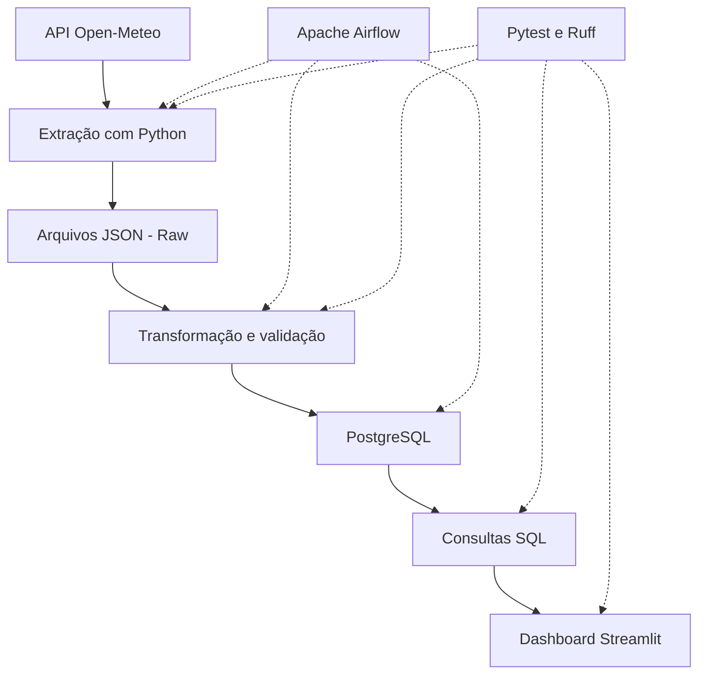

# Arquitetura do WeatherFlow

## 1. Visão geral

O WeatherFlow é um projeto de Engenharia de Dados que
automatiza a coleta, transformação, armazenamento e
visualização de previsões meteorológicas.

O objetivo é demonstrar um pipeline de dados de ponta
a ponta, utilizando tecnologias comuns no desenvolvimento
de soluções analíticas.

## 2. Problema de negócio

Informações meteorológicas podem apoiar decisões em
logística, operações, comércio e planejamento de atividades.

Entretanto, consultar uma API manualmente não oferece
um histórico organizado nem uma forma padronizada de
analisar as previsões.

O WeatherFlow demonstra como automatizar esse processo
e disponibilizar informações para análise.

## 3. Arquitetura lógica



## 4. Componentes

### API Open-Meteo

Fonte externa de dados meteorológicos.

### Python

Responsável pela extração, transformação,
validação e carregamento dos dados.

### JSON

Formato utilizado para preservar os dados
brutos recebidos da API.

### PostgreSQL

Banco relacional responsável pelo armazenamento
das previsões meteorológicas.

### Apache Airflow

Orquestrador que coordena as tarefas de
extração e carregamento do pipeline.

### Streamlit

Interface analítica utilizada para consultar
e visualizar as previsões armazenadas.

### Pytest e Ruff

Ferramentas de testes automatizados, análise
estática e padronização do código.

## 5. Idempotência

O pipeline utiliza uma restrição de unicidade
para evitar duplicações da mesma coleta.

A combinação utilizada é:

- city
- forecast_date
- collected_at

Essa estratégia permite executar novamente
um carregamento sem duplicar registros que
possuam a mesma chave.

Uma nova coleta, com outro collected_at,
pode representar uma nova versão da previsão.

## 6. Camada analítica

As consultas SQL recuperam as previsões
mais recentes para cada cidade e data.

O dashboard apresenta:

- Quantidade de previsões
- Quantidade de cidades
- Temperatura máxima
- Temperatura mínima
- Precipitação prevista
- Gráficos meteorológicos
- Filtros e tabela analítica
- Exportação CSV

## 7. Qualidade de software

O projeto utiliza testes automatizados
para validar componentes de Engenharia
de Dados e a interface Streamlit.

Na conclusão da Etapa 5:

- 63 testes automatizados aprovados
- Ruff sem erros
- Código integrado à branch main

## 8. Limitações

- O projeto trabalha com um conjunto reduzido de cidades.
- As previsões são fornecidas por uma API externa.
- Não há garantia de disponibilidade contínua da API.
- Os dados representam previsões, não medições observadas.
- O dashboard não é uma plataforma meteorológica operacional.

## 9. Possíveis evoluções

- Monitoramento estruturado das execuções
- Alertas básicos de falha
- Histórico de qualidade das coletas
- Comparação entre previsões e observações reais
```
