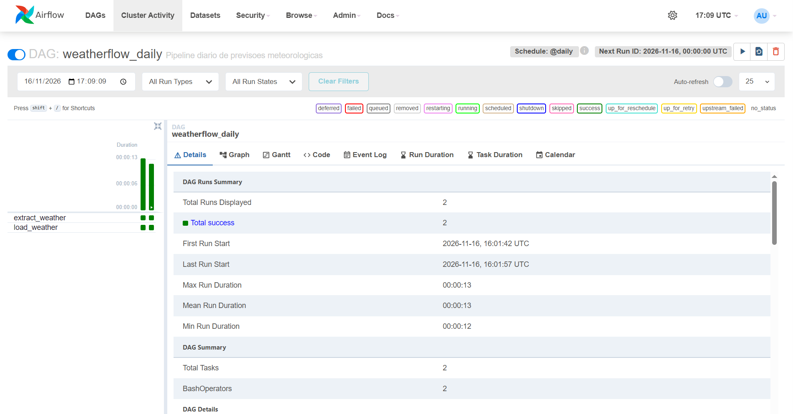
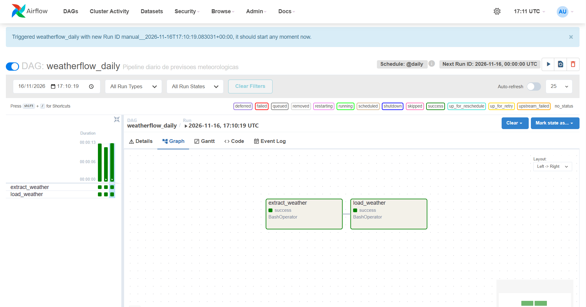
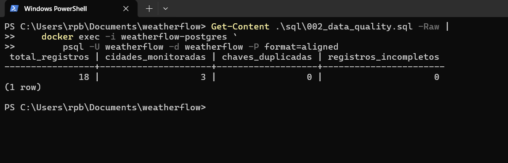
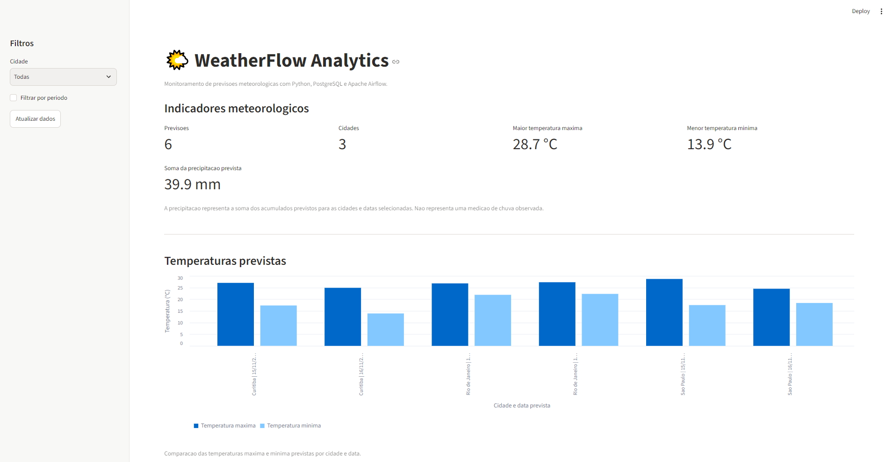
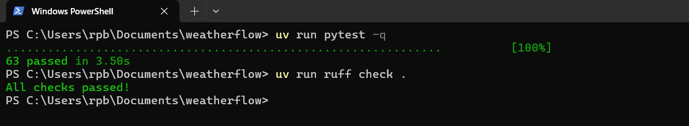

# Evidências Técnicas — WeatherFlow

Este documento apresenta evidências de execução,
qualidade e funcionamento do pipeline WeatherFlow.

## 1. Apache Airflow — DAG

DAG: `weatherflow_daily`

Tarefas:
- `extract_weather`
- `load_weather`

## 2. Apache Airflow — Execuções

Resultados verificados:
- 2 execuções registradas
- 2 execuções bem-sucedidas
- 0 falhas nas execuções consultadas

## 3. PostgreSQL — Qualidade dos Dados

| Indicador | Resultado |
|---|---:|
| Registros armazenados | 18 |
| Cidades monitoradas | 3 |
| Chaves duplicadas | 0 |
| Identificações incompletas | 0 |

Consulta SQL:
[`sql/002_data_quality.sql`](../sql/002_data_quality.sql)

Os resultados correspondem à validação realizada
após a nova execução do pipeline.

## 4. Streamlit — Dashboard

O dashboard apresenta indicadores meteorológicos,
filtros, gráficos e uma tabela analítica.

## 5. Testes Automatizados

Resultados:
- 63 testes aprovados
- Ruff sem erros

## 6. Conclusão

As evidências demonstram o funcionamento dos
principais componentes do WeatherFlow:

- Extração e processamento de dados
- Armazenamento no PostgreSQL
- Orquestração com Apache Airflow
- Consultas de qualidade com SQL
- Visualização com Streamlit
- Testes automatizados
